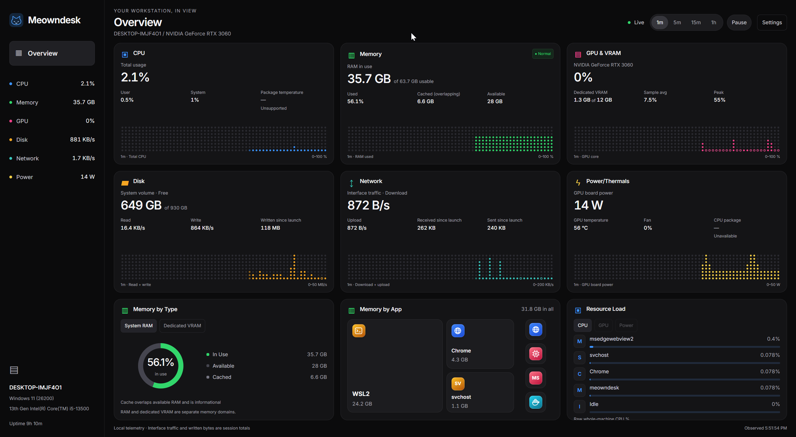

# Meowndesk

Meowndesk is a local, read-only hardware monitor for Windows 10/11 and Linux,
built with Tauri 2, Rust, React 19 and TypeScript. Version **0.1.0** brings live
hardware readings, memory breakdowns and process rankings into one desktop
Overview.



Meowndesk Overview on Windows 11. Available readings depend on hardware and drivers.

## Download

Download the latest installers from
[GitHub Releases](https://github.com/vucat/meowndesk/releases/latest).

| Platform            | Package     | Installation                                  |
| ------------------- | ----------- | --------------------------------------------- |
| Windows 10/11 x64   | `.exe`      | Run the NSIS installer. WebView2 is required. |
| Debian / Ubuntu x64 | `.deb`      | Install with your system's package manager.   |
| Linux x64           | `.AppImage` | Make the file executable, then run it.        |

For an AppImage, run `chmod +x Meowndesk_*.AppImage` after downloading it.
Linux requires a graphical session and the runtime libraries described below.
Installers are **unsigned**. Native hardware acceptance, installer/offline checks,
and long-duration benchmarks remain pending; see [Validation status](#validation-status).

## Features

- CPU and RAM usage, selected GPU/VRAM, system-volume capacity and I/O,
  network traffic, and available power and thermal readings.
- Memory breakdowns by app and type, plus process resource rankings.
- **1m, 5m, 15m and 1h** history ranges with 60 chart columns.
- Pause/Resume for inspecting a frozen view while background collection continues.
- Saved settings for the **1-, 2- or 5-second** collection interval and selected GPU.
- Local assets and in-memory history; no account or outbound telemetry.

Missing sensors remain explicitly unavailable, denied or stale. Required
CPU/RAM/system-volume/network/readable-process failures show **Degraded
monitoring**; optional GPU, battery, power and thermal absence does not.
WSL2 is labeled **guest resources only** and cannot establish native Windows
or native Linux workstation acceptance.

## Development prerequisites

To build from source, use Node **24.22.0** as pinned in `.nvmrc` (`nvm install && nvm use`) and
official stable Rust with edition 2024 support and rustc **1.90 or newer**.
`rust-toolchain.toml` requests Clippy/rustfmt; `package-lock.json` and
`src-tauri/Cargo.lock` pin dependencies.

- Windows x64: MSVC Rust target, Visual Studio C++ Desktop Build Tools, Windows
  SDK and Microsoft Edge WebView2 runtime.
- Linux x64: graphical session, compiler/linker, pkg-config, WebKitGTK 4.1,
  OpenSSL, AppIndicator and librsvg development/runtime libraries. On Ubuntu:

  ```sh
  sudo apt-get install build-essential pkg-config libwebkit2gtk-4.1-dev libssl-dev libayatana-appindicator3-dev librsvg2-dev
  ```

Distribution package names vary; see [Tauri prerequisites](https://v2.tauri.app/start/prerequisites/).
NVIDIA telemetry uses the installed NVML driver library; no CUDA toolkit or
privileged helper is required. AMD/Intel/no-GPU systems must retain the other
cards; their native hardware validation remains pending.

## Development

```sh
npm ci
npm run tauri dev
```

`npm run dev` serves the frontend at 127.0.0.1:1420. Hardware IPC requires the
native shell. Browser fixtures run separately and never enter the production
frontend. See [Verification](#verification) for automated checks and
[Build and native validation](#build-and-native-validation) for hardware testing.

## Verification

```sh
npm run typecheck
npm run lint
npm run test:unit
npm run build
cargo clippy --manifest-path src-tauri/Cargo.toml --all-targets --all-features -- -D warnings
cargo test --manifest-path src-tauri/Cargo.toml
npm run test:browser
```

Install Chromium once with `npx playwright install chromium`. Optional style
checks: `npm run format:check` and `cargo fmt --manifest-path src-tauri/Cargo.toml --check`.
Tests/lint do not rewrite sources; `npm run format` explicitly formats them.

## Build and native validation

```sh
npm run tauri build
MEOWNDESK_BINARY=src-tauri/target/release/meowndesk npm run test:native
```

Use the Tauri CLI to embed the production frontend/CSP before native tests or
profiling; a bare Cargo build is a compilation check and may use the configured
development URL. Windows uses `meowndesk.exe` and PowerShell environment-variable
syntax. Bundles are under `src-tauri/target/release/bundle/`: Linux deb/AppImage,
Windows NSIS. Windows target configuration is in `src-tauri/tauri.windows.conf.json`.
Build prerequisites/downloads may require internet; runtime assets are local.
Installers are unsigned. GitHub Actions builds and uploads packages as described below.

Native tests require `cargo install tauri-driver --locked` plus WebKitWebDriver
on Linux or msedgedriver matching WebView2 on Windows. Ubuntu versions may call
the package `webkit2gtk-driver` or `webkitgtk-webdriver`. Set `TAURI_DRIVER` and
`NATIVE_WEBDRIVER` to executable overrides. Missing prerequisites fail clearly.

Python 3.10+ profiling and soak commands, ownership/accounting details, timing
boundaries and native trace configuration are documented in
[scripts/validation/README.md](scripts/validation/README.md). Defaults are
10-minute warmup + 30-minute profiling and a 24-hour soak. Short smoke runs
exercise the scripts only; <60 MB/<1% CPU, 16.7 ms frames and 24-hour stability
remain unmeasured optimization targets. Native visible-feedback timings require
20 separate trials per range/Pause/Resume category.

On native Windows and Linux, check live readings, all history ranges,
Pause/Resume, settings persistence, hide/restore, suspend/resume, and operation
without a network connection. Exercise missing sensors and GPU changes where
hardware permits. Record the OS, hardware, display scaling, commands and results
under `artifacts/validation/`; fixture tests and WSLg observations do not replace
these native checks.

## GitHub builds and releases

The source repository is [vucat/meowndesk](https://github.com/vucat/meowndesk).
The [Build desktop packages workflow](https://github.com/vucat/meowndesk/actions/workflows/build.yml)
runs on pushes to `main`, pull requests targeting `main`, version tags, and manual
dispatch. Native Ubuntu 22.04 and Windows Server 2022 x64 runners execute Clippy,
Cargo tests, TypeScript, ESLint and Vitest before packaging the production app.

Open a successful workflow run and download its `meowndesk-linux-x64-<commit>`
or `meowndesk-windows-x64-<commit>` artifact. Artifacts require repository access
and expire after 14 days. Linux includes `.deb` and `.AppImage`; Windows includes
the NSIS `.exe` installer. Extract the artifact ZIP before installing; Linux users
may need `chmod +x Meowndesk_*.AppImage` before running an extracted AppImage.
Missing or empty installers fail the workflow.

**Matching version tags publish releases automatically.** To publish the next
release, update `package.json`, `package-lock.json`,
`src-tauri/Cargo.toml`, `src-tauri/Cargo.lock` and `src-tauri/tauri.conf.json` to the
same version, commit and push to `main`, then tag that commit. For example, after
updating all versions to `0.1.1`:

```sh
git tag -a v0.1.1 -m "Meowndesk v0.1.1"
git push origin v0.1.1
```

Use stable `vMAJOR.MINOR.PATCH` tags. Tag versions must match the package, Cargo
and Tauri versions. Once both builds succeed, the release job uploads all three
installers to a draft and then publishes it under
[Releases](https://github.com/vucat/meowndesk/releases). An interrupted upload
leaves a draft that can be completed by rerunning the failed job. Published
releases are not overwritten. Pull requests, branch pushes and manual runs
cannot publish releases. Only the release job receives write access, using
GitHub's automatic `GITHUB_TOKEN`; no additional publishing secret is required.

Pushing the matching version tag is the publication step; no manual release
creation is required. Ordinary pushes produce Actions artifacts that expire
after 14 days. Signing and automatic updates are not configured.
CI builds do not establish native hardware acceptance or the pending installer,
offline and long-duration validation results below.

## Scope and privacy

No accounts, outbound telemetry, remote assets, process control, AI-server
integration or elevated runtime privileges are required. History/session byte
counters live only in memory. Preferences use one fixed app-config JSON file;
IPC exposes eight allowlisted commands solely to the bundled main window.
Production fixture controls are absent. Process names are rendered as text;
no arbitrary filesystem/shell/HTTP command interface is exposed.

Disk I/O requires an exact system-volume match. Network figures aggregate
active non-loopback interfaces and session-observed deltas, not billing usage.
Shared process pages can be counted more than once. GPU attribution, dedicated
VRAM, measured process power, battery and thermal sensors depend on providers;
unavailable attribution is never estimated as a measured value. macOS is not
a primary supported platform.

## Validation status

The application and automated test suites are implemented. Native acceptance
on Windows/Ubuntu reference machines, installer/offline checks,
real suspend and multi-GPU scenarios, and full-duration reference benchmarks
remain pending. WSLg and observations on other machines are provisional evidence.

Local validation reports and test captures belong under ignored
`artifacts/validation/`. Documentation images are kept in `docs/images/`. See
[Build and native validation](#build-and-native-validation) and the
[profiling and soak documentation](scripts/validation/README.md) to reproduce
checks and record platform-specific results.
